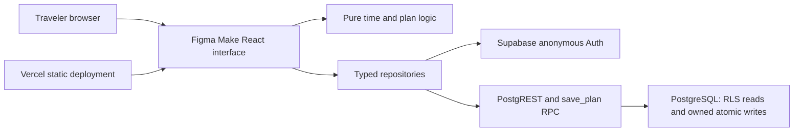

# Architecture decided before application implementation
Decision date: 2026-11-11. Repository baseline contained only README.md. Existing Figma Design reference inspected as metadata; generated Figma Make source is not yet available.

## Stack and boundaries
React + TypeScript from Figma Make; use its existing Vite setup if present. Do not migrate frameworks merely to match this proposal. Supabase hosts PostgreSQL and anonymous Auth. Browser reads catalogue and owner-scoped plans via supabase-js; one SQL RPC saves parent and children atomically. Vercel serves the app. No custom API server, ORM, realtime subscriptions or external flight APIs required.



Trust boundary: everything in the browser is untrusted. Public catalogue reads are intentional. RLS restricts plan reads; authenticated-role table writes are revoked. The security-definer RPC explicitly authenticates, validates ownership and revisions, fixes search_path, and checks airport consistency. Its owner must remain the migration administrator, never an app role. Public function execution is revoked. No service key enters the app.

## Proposed folders after export integration
```text
src/
  app/                 routing and providers (adapt to export)
  components/          reused Figma Make presentation and primitives
  features/airports/   catalogue views
  features/planner/    form, builder, saved plans
  domain/              pure calculations and draft operations
  data/                supabase client, auth, catalogue and plan repositories
  types/               generated database.types.ts + domain types
  test/                unit/component fixtures
public/                licensed exported assets
supabase/migrations/   versioned schema and security/RPC SQL
supabase/seed.sql       explicit demo catalogue only
supabase/config.toml   generated by supabase init during implementation
 tests/                unit/integration/E2E; database harness already provided
 docs/                 architecture, requirements, schema, evidence and release
```
The src tree is proposed, not created. Preserve the export's structure where reasonable; document actual mappings.

## Decisions and tradeoffs
- Anonymous users avoid an account form but cannot recover after browser storage loss. Account upgrade is deferred.
- Client UUID + revision detects duplicate creates and stale edits. Entire save is transactional; failures roll back parent and items.
- Saved duration snapshots stabilize budgets; activity names/details are joined from a frozen demo catalogue. Full historical content snapshots are deferred.
- Composite foreign keys forbid cross-airport template/plan items even if UI validation fails.
- Scope limits (48h layover, 20 activities) are product decisions for this MVP, not assignment requirements or travel rules.
- No generated UI in this package: Figma Make owns the initial frontend; Claude wires real behavior and improves it after review.

## API/repository contract
`listAirports()`, `listActivities(airportId)`, `listTemplates(airportId)` read database and order template items by position. `ensureGuestSession()` first checks existing session; serialize concurrent calls, then signInAnonymously only if absent. `listPlans()` reads owner-visible layovers newest first. `getPlan(id)` fetches parent and ordered items with activity details; unavailable if no parent. `savePlan(draft, expectedRevision)` calls the SQL RPC, then re-fetches; return the server revision. Use typed Supabase query errors, not success-shaped fallback data.

RPC parameters exactly: p_id UUID; p_expected_revision integer; p_airport_id text; p_arrival_at/p_departure_at ISO timestamp with offset; p_buffer_minutes integer; p_activity_ids ordered UUID array. No owner/duration supplied. Empty array is valid. New plan uses crypto.randomUUID() once and revision 0; retain ID across retry. Update uses loaded revision. SQLSTATE PT409 (HTTP 409) means conflict, 42501 auth/unavailable, 22023 invalid request, 23514/23503 constraint/record validation. Sanitize UI errors; keep diagnostic codes in development.
