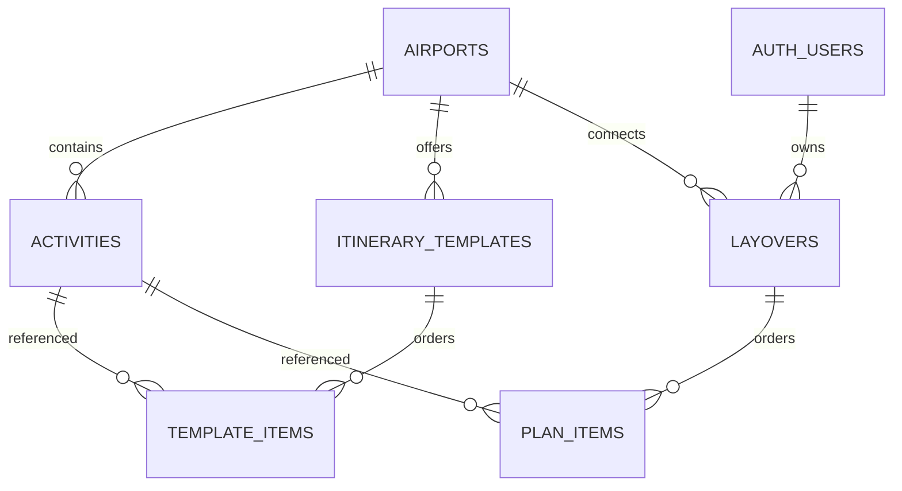

# Database design
SQL migrations are authoritative for executable details. Apply 001 then 002, followed by seed.sql. No existing remote schema has been inspected. Tables live in public; auth.users is Supabase-managed. All columns are NOT NULL; primary keys are unique; defaults shown below.

## Data dictionary
| Table | Columns and types | Keys, constraints and purpose |
|---|---|---|
| airports | id text; name text; timezone text; dataset_label text default illustrative notice | PK id, exactly three uppercase letters. Airport identity + IANA timezone. Validate zone against PostgreSQL pg_timezone_names at seed/import time. |
| activities | id uuid default gen_random_uuid(); airport_id text; name text; description text; category text; terminal text default Unverified; access_zone text; duration_minutes integer; budget_label text default Unknown; is_demo boolean default true | PK id; FK airport_id → airports.id; UNIQUE(id,airport_id). Category food/rest/shopping/culture/work; access airside/landside/unknown; duration 1–1440. Real operating hours/images omitted rather than invented. |
| itinerary_templates | id uuid default gen_random_uuid(); airport_id text; name text; description text | PK id; FK airport_id → airports.id; UNIQUE(id,airport_id). Curated plan headers; total derived from items. |
| template_items | template_id uuid; airport_id text; activity_id uuid; position integer | PK(template_id,position); UNIQUE(template_id,activity_id); position 1–20. Composite FK(template_id,airport_id) → templates(id,airport_id), delete cascade; composite FK(activity_id,airport_id) → activities(id,airport_id). Ordered template membership. |
| layovers | id uuid; owner_id uuid; airport_id text; arrival_at timestamptz; departure_at timestamptz; buffer_minutes integer; revision integer default 1; created_at/updated_at timestamptz default now() | PK id, client generated; owner FK → auth.users.id delete cascade; airport FK → airports.id; UNIQUE(id,airport_id). Finite dates, departure > arrival, <=48h; buffer 0–1440; revision >0. Guest-owned saved plan. |
| plan_items | layover_id uuid; airport_id text; activity_id uuid; position integer; duration_minutes integer | PK(layover_id,position); UNIQUE(layover_id,activity_id); position 1–20, duration 1–1440. Composite FK(layover_id,airport_id) → layovers(id,airport_id), delete cascade; composite FK(activity_id,airport_id) → activities(id,airport_id). Server copies duration at save. |

Non-cascade FKs use PostgreSQL default NO ACTION: referenced catalogue records cannot be casually deleted. Delete account cascades to plans/items. No end-user delete requirement in MVP; do not add a public delete endpoint. Auth user deletion is a privileged dashboard/admin operation.

## Access matrix
| Resource | No session (anon role) | Anonymous signed-in user (authenticated role) | Privileged migration administrator |
|---|---|---|---|
| Catalogue 4 tables | SELECT | SELECT | Manage |
| layovers, plan_items | No access | SELECT own rows only | Manage |
| Direct INSERT/UPDATE/DELETE | Denied | Denied | Manage |
| save_plan RPC | Denied | Own plan create/update; server derives auth.uid() | Not needed for normal app |

RLS enabled on all six tables. Anonymous sign-in users receive authenticated database role; they are distinct from the unauthenticated anon API role. Plan-child reads depend on owner-visible parent. No user_profiles table needed; avoid storing extra personal data. Indexes cover catalogue airport filters and owner/newest plans; item PKs cover parent/order reads.

## Save invariants
RPC checks authenticated identity, required fields, nonnegative expected revision, <=20 distinct non-null activity IDs and same-airport membership. Constraints enforce timestamps and buffer limits. It locks an existing owned row, compares revision, increments revision and replaces children within one transaction. Any exception rolls everything back. A repeated new UUID fails as conflict, never creates duplicates. A guessed UUID cannot take ownership. Over-budget plans are allowed as drafts; client must show warning. Future-date validation is UI policy, not a changing database CHECK constraint.

## Seed and change policy
Seed contains two airports, eight fictional demo experiences, two templates, four ordered template items and no users/plans. Airport names/zones are contextual; facility/access/budget claims are explicitly illustrative, not verified travel facts. Run seed twice safely (ON CONFLICT DO NOTHING); it does not update existing data. For changes, write a new reviewed migration. Keep catalogue stable through demo; snapshot durations preserve previous totals until a subsequent save. No rollback script that drops user data; back up and use forward fixes after release.
