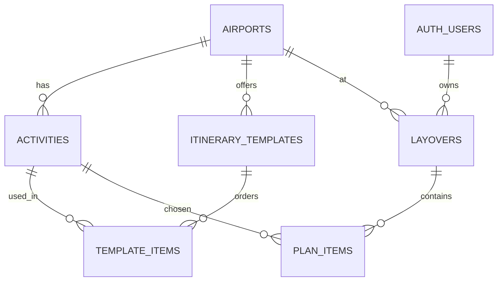

# Database tables as implemented (generated from the live Supabase project)

Source: `information_schema` / `pg_constraint` of project `sgwbtgwccskqamzttczz`, queried read-only on 2026-11-12. Regenerate rather than edit by hand. All columns are NOT NULL unless marked.

## `airports`
Airport identity and IANA time zone (the zone all layover times are entered in).

| # | Column | Type | Null? | Default |
|---|---|---|---|---|
| 1 | `id` | text | no |  |
| 2 | `name` | text | no |  |
| 3 | `timezone` | text | no |  |
| 4 | `dataset_label` | text | no | `'Illustrative demo catalogue; not travel guidance'::text` |

| Kind | Constraint |
|---|---|
| Primary key | `PRIMARY KEY (id)` |
| Check | `CHECK ((id ~ '^[A-Z]{3}$'::text))` |

## `activities`
Illustrative layover activities per airport (category, access zone, duration, budget wording).

| # | Column | Type | Null? | Default |
|---|---|---|---|---|
| 1 | `id` | uuid | no | `gen_random_uuid()` |
| 2 | `airport_id` | text | no |  |
| 3 | `name` | text | no |  |
| 4 | `description` | text | no |  |
| 5 | `category` | text | no |  |
| 6 | `terminal` | text | no | `'Unverified'::text` |
| 7 | `access_zone` | text | no |  |
| 8 | `duration_minutes` | integer | no |  |
| 9 | `budget_label` | text | no | `'Unknown'::text` |
| 10 | `is_demo` | boolean | no | `true` |

| Kind | Constraint |
|---|---|
| Primary key | `PRIMARY KEY (id)` |
| Foreign key | `FOREIGN KEY (airport_id) REFERENCES airports(id)` |
| Unique | `UNIQUE (id, airport_id)` |
| Check | `CHECK ((access_zone = ANY (ARRAY['airside'::text, 'landside'::text, 'unknown'::text])))` |
| Check | `CHECK ((category = ANY (ARRAY['food'::text, 'rest'::text, 'shopping'::text, 'culture'::text, 'work'::text])))` |
| Check | `CHECK (((duration_minutes >= 1) AND (duration_minutes <= 1440)))` |

## `itinerary_templates`
Curated itinerary headers per airport.

| # | Column | Type | Null? | Default |
|---|---|---|---|---|
| 1 | `id` | uuid | no | `gen_random_uuid()` |
| 2 | `airport_id` | text | no |  |
| 3 | `name` | text | no |  |
| 4 | `description` | text | no |  |

| Kind | Constraint |
|---|---|
| Primary key | `PRIMARY KEY (id)` |
| Foreign key | `FOREIGN KEY (airport_id) REFERENCES airports(id)` |
| Unique | `UNIQUE (id, airport_id)` |

## `template_items`
Ordered activities that make up each curated itinerary.

| # | Column | Type | Null? | Default |
|---|---|---|---|---|
| 1 | `template_id` | uuid | no |  |
| 2 | `airport_id` | text | no |  |
| 3 | `activity_id` | uuid | no |  |
| 4 | `position` | integer | no |  |

| Kind | Constraint |
|---|---|
| Primary key | `PRIMARY KEY (template_id, "position")` |
| Foreign key | `FOREIGN KEY (activity_id, airport_id) REFERENCES activities(id, airport_id)` |
| Foreign key | `FOREIGN KEY (template_id, airport_id) REFERENCES itinerary_templates(id, airport_id) ON DELETE CASCADE` |
| Unique | `UNIQUE (template_id, activity_id)` |
| Check | `CHECK ((("position" >= 1) AND ("position" <= 20)))` |

## `layovers`
A guest's saved layover: airport, arrival/departure instants (UTC), buffer, revision. Owned by the anonymous guest.

| # | Column | Type | Null? | Default |
|---|---|---|---|---|
| 1 | `id` | uuid | no |  |
| 2 | `owner_id` | uuid | no |  |
| 3 | `airport_id` | text | no |  |
| 4 | `arrival_at` | timestamptz | no |  |
| 5 | `departure_at` | timestamptz | no |  |
| 6 | `buffer_minutes` | integer | no |  |
| 7 | `revision` | integer | no | `1` |
| 8 | `created_at` | timestamptz | no | `now()` |
| 9 | `updated_at` | timestamptz | no | `now()` |

| Kind | Constraint |
|---|---|
| Primary key | `PRIMARY KEY (id)` |
| Foreign key | `FOREIGN KEY (airport_id) REFERENCES airports(id)` |
| Foreign key | `FOREIGN KEY (owner_id) REFERENCES auth.users(id) ON DELETE CASCADE` |
| Unique | `UNIQUE (id, airport_id)` |
| Check | `CHECK (((buffer_minutes >= 0) AND (buffer_minutes <= 1440)))` |
| Check | `CHECK ((isfinite(arrival_at) AND isfinite(departure_at)))` |
| Check | `CHECK (((departure_at > arrival_at) AND (departure_at <= (arrival_at + '48:00:00'::interval))))` |
| Check | `CHECK ((revision > 0))` |

## `plan_items`
Ordered activities in a saved layover, with the duration copied at save time.

| # | Column | Type | Null? | Default |
|---|---|---|---|---|
| 1 | `layover_id` | uuid | no |  |
| 2 | `airport_id` | text | no |  |
| 3 | `activity_id` | uuid | no |  |
| 4 | `position` | integer | no |  |
| 5 | `duration_minutes` | integer | no |  |

| Kind | Constraint |
|---|---|
| Primary key | `PRIMARY KEY (layover_id, "position")` |
| Foreign key | `FOREIGN KEY (activity_id, airport_id) REFERENCES activities(id, airport_id)` |
| Foreign key | `FOREIGN KEY (layover_id, airport_id) REFERENCES layovers(id, airport_id) ON DELETE CASCADE` |
| Unique | `UNIQUE (layover_id, activity_id)` |
| Check | `CHECK (((duration_minutes >= 1) AND (duration_minutes <= 1440)))` |
| Check | `CHECK ((("position" >= 1) AND ("position" <= 20)))` |

## Relationships

## Indexes
| Table | Index |
|---|---|
| `activities` | `activities_airport` |
| `activities` | `activities_id_airport_id_key` |
| `activities` | `activities_pkey` |
| `airports` | `airports_pkey` |
| `itinerary_templates` | `itinerary_templates_id_airport_id_key` |
| `itinerary_templates` | `itinerary_templates_pkey` |
| `itinerary_templates` | `templates_airport` |
| `layovers` | `layovers_id_airport_id_key` |
| `layovers` | `layovers_owner_updated` |
| `layovers` | `layovers_pkey` |
| `plan_items` | `plan_items_layover_id_activity_id_key` |
| `plan_items` | `plan_items_pkey` |
| `template_items` | `template_items_pkey` |
| `template_items` | `template_items_template_id_activity_id_key` |
