# SkyStop — Assignment 2 MVP (draft for the PDF)
**Status: DRAFT assembled by Claude Code on 2026-11-12 from the running application and the live database. The student must review it, complete the items marked ✏️, and verify the final PDF before uploading to Moodle.**

Public application: **https://skystop.vercel.app** · Source: https://github.com/gledaui707/SkyStop (branch `main`) · Individual work.

## 1. What the application does
SkyStop helps a traveller see how much usable time a layover really offers and plan it. The traveller enters a booked connection (route, connecting airport, arrival and departure in airport-local time, a reserved airport buffer), explores illustrative activities for two airports (Lisbon LIS and Singapore SIN) on a map or list, picks a curated itinerary or individual activities, sees the remaining time recalculated at once (total − buffer − planned), saves the plan, and later retrieves and edits it. Saved plans live in PostgreSQL and belong to an anonymous guest session of the browser. No account form is needed.

Illustrative, not travel advice: all activities, durations, budget wording, access zones and map positions are demo data (marked as such in the app). Flight comparison screens use illustrative sample schedules and prices.

## 2. Architecture
React + TypeScript + Vite (frontend from the Figma Make export, wired to real data) → Supabase (PostgreSQL, anonymous Auth, PostgREST) → deployed on Vercel. No custom server. Domain logic (time zones, budget arithmetic, daylight-saving handling) is a separate pure module (`src/domain`) with its own tests. All writes go through one server-side function `save_plan` that checks the guest's identity and ownership and saves a plan and its items in one transaction; the browser has no direct write access to tables.

## 3. Database
Six tables (live definitions generated from the running Supabase project): `airports`, `activities`, `itinerary_templates`, `template_items`, `layovers`, `plan_items`. Row-level security is enabled on all six: catalogue tables are readable by everyone; `layovers` and `plan_items` are readable only by their owner (the anonymous guest). Direct INSERT/UPDATE/DELETE by browser roles is not granted; `save_plan` is executable only by signed-in guests. Seed data: 2 airports, 8 activities, 2 curated itineraries, 4 itinerary items.

### `airports`
Airport identity and IANA time zone (the zone all layover times are entered in).

| # | Column | Type | Null? | Default |
|---|---|---|---|---|
| 1 | `id` | text | no |  |
| 2 | `name` | text | no |  |
| 3 | `timezone` | text | no |  |
| 4 | `dataset_label` | text | no | `'Illustrative demo catalogue; not travel guidance'::text` |

| Kind | Constraint |
|---|---|
| Primary key | `PRIMARY KEY (id)` |
| Check | `CHECK ((id ~ '^[A-Z]{3}$'::text))` |

### `activities`
Illustrative layover activities per airport (category, access zone, duration, budget wording).

| # | Column | Type | Null? | Default |
|---|---|---|---|---|
| 1 | `id` | uuid | no | `gen_random_uuid()` |
| 2 | `airport_id` | text | no |  |
| 3 | `name` | text | no |  |
| 4 | `description` | text | no |  |
| 5 | `category` | text | no |  |
| 6 | `terminal` | text | no | `'Unverified'::text` |
| 7 | `access_zone` | text | no |  |
| 8 | `duration_minutes` | integer | no |  |
| 9 | `budget_label` | text | no | `'Unknown'::text` |
| 10 | `is_demo` | boolean | no | `true` |

| Kind | Constraint |
|---|---|
| Primary key | `PRIMARY KEY (id)` |
| Foreign key | `FOREIGN KEY (airport_id) REFERENCES airports(id)` |
| Unique | `UNIQUE (id, airport_id)` |
| Check | `CHECK ((access_zone = ANY (ARRAY['airside'::text, 'landside'::text, 'unknown'::text])))` |
| Check | `CHECK ((category = ANY (ARRAY['food'::text, 'rest'::text, 'shopping'::text, 'culture'::text, 'work'::text])))` |
| Check | `CHECK (((duration_minutes >= 1) AND (duration_minutes <= 1440)))` |

### `itinerary_templates`
Curated itinerary headers per airport.

| # | Column | Type | Null? | Default |
|---|---|---|---|---|
| 1 | `id` | uuid | no | `gen_random_uuid()` |
| 2 | `airport_id` | text | no |  |
| 3 | `name` | text | no |  |
| 4 | `description` | text | no |  |

| Kind | Constraint |
|---|---|
| Primary key | `PRIMARY KEY (id)` |
| Foreign key | `FOREIGN KEY (airport_id) REFERENCES airports(id)` |
| Unique | `UNIQUE (id, airport_id)` |

### `template_items`
Ordered activities that make up each curated itinerary.

| # | Column | Type | Null? | Default |
|---|---|---|---|---|
| 1 | `template_id` | uuid | no |  |
| 2 | `airport_id` | text | no |  |
| 3 | `activity_id` | uuid | no |  |
| 4 | `position` | integer | no |  |

| Kind | Constraint |
|---|---|
| Primary key | `PRIMARY KEY (template_id, "position")` |
| Foreign key | `FOREIGN KEY (activity_id, airport_id) REFERENCES activities(id, airport_id)` |
| Foreign key | `FOREIGN KEY (template_id, airport_id) REFERENCES itinerary_templates(id, airport_id) ON DELETE CASCADE` |
| Unique | `UNIQUE (template_id, activity_id)` |
| Check | `CHECK ((("position" >= 1) AND ("position" <= 20)))` |

### `layovers`
A guest's saved layover: airport, arrival/departure instants (UTC), buffer, revision. Owned by the anonymous guest.

| # | Column | Type | Null? | Default |
|---|---|---|---|---|
| 1 | `id` | uuid | no |  |
| 2 | `owner_id` | uuid | no |  |
| 3 | `airport_id` | text | no |  |
| 4 | `arrival_at` | timestamptz | no |  |
| 5 | `departure_at` | timestamptz | no |  |
| 6 | `buffer_minutes` | integer | no |  |
| 7 | `revision` | integer | no | `1` |
| 8 | `created_at` | timestamptz | no | `now()` |
| 9 | `updated_at` | timestamptz | no | `now()` |

| Kind | Constraint |
|---|---|
| Primary key | `PRIMARY KEY (id)` |
| Foreign key | `FOREIGN KEY (airport_id) REFERENCES airports(id)` |
| Foreign key | `FOREIGN KEY (owner_id) REFERENCES auth.users(id) ON DELETE CASCADE` |
| Unique | `UNIQUE (id, airport_id)` |
| Check | `CHECK (((buffer_minutes >= 0) AND (buffer_minutes <= 1440)))` |
| Check | `CHECK ((isfinite(arrival_at) AND isfinite(departure_at)))` |
| Check | `CHECK (((departure_at > arrival_at) AND (departure_at <= (arrival_at + '48:00:00'::interval))))` |
| Check | `CHECK ((revision > 0))` |

### `plan_items`
Ordered activities in a saved layover, with the duration copied at save time.

| # | Column | Type | Null? | Default |
|---|---|---|---|---|
| 1 | `layover_id` | uuid | no |  |
| 2 | `airport_id` | text | no |  |
| 3 | `activity_id` | uuid | no |  |
| 4 | `position` | integer | no |  |
| 5 | `duration_minutes` | integer | no |  |

| Kind | Constraint |
|---|---|
| Primary key | `PRIMARY KEY (layover_id, "position")` |
| Foreign key | `FOREIGN KEY (activity_id, airport_id) REFERENCES activities(id, airport_id)` |
| Foreign key | `FOREIGN KEY (layover_id, airport_id) REFERENCES layovers(id, airport_id) ON DELETE CASCADE` |
| Unique | `UNIQUE (layover_id, activity_id)` |
| Check | `CHECK (((duration_minutes >= 1) AND (duration_minutes <= 1440)))` |
| Check | `CHECK ((("position" >= 1) AND ("position" <= 20)))` |

### Relationships
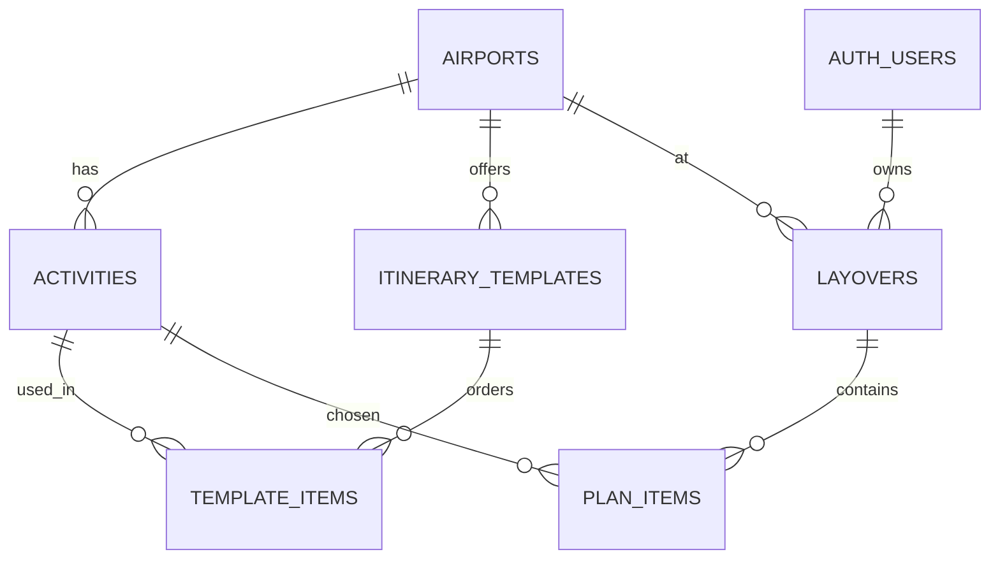

### Indexes
| Table | Index |
|---|---|
| `activities` | `activities_airport` |
| `activities` | `activities_id_airport_id_key` |
| `activities` | `activities_pkey` |
| `airports` | `airports_pkey` |
| `itinerary_templates` | `itinerary_templates_id_airport_id_key` |
| `itinerary_templates` | `itinerary_templates_pkey` |
| `itinerary_templates` | `templates_airport` |
| `layovers` | `layovers_id_airport_id_key` |
| `layovers` | `layovers_owner_updated` |
| `layovers` | `layovers_pkey` |
| `plan_items` | `plan_items_layover_id_activity_id_key` |
| `plan_items` | `plan_items_pkey` |
| `template_items` | `template_items_pkey` |
| `template_items` | `template_items_template_id_activity_id_key` |

## 4. Application screenshots (real, from the deployed app)
Captured on 2026-11-12 from https://skystop.vercel.app in a phone-sized browser (iPhone 13 viewport) while running the complete journey against the live database (files in `docs/screenshots/`). Photos are illustrative Unsplash images.

**Figure — Welcome screen (first visit): one action to add a flight.**

**Figure — Step 1: the traveller enters the booked route (origin and destination airports).**

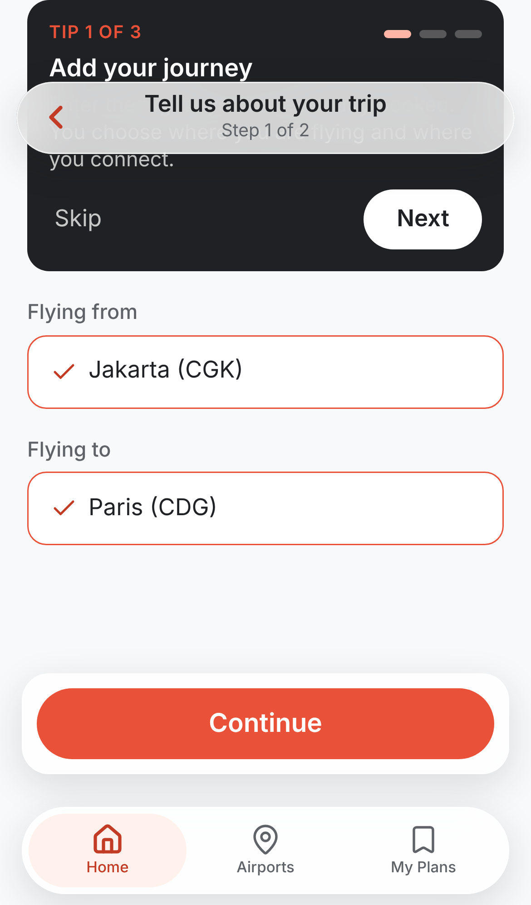

**Figure — Step 2: connecting airport (Lisbon, from the database), arrival and departure in airport-local time, reserved buffer, and the live time breakdown (5 h − 1 h 30 m = 3 h 30 m usable).**

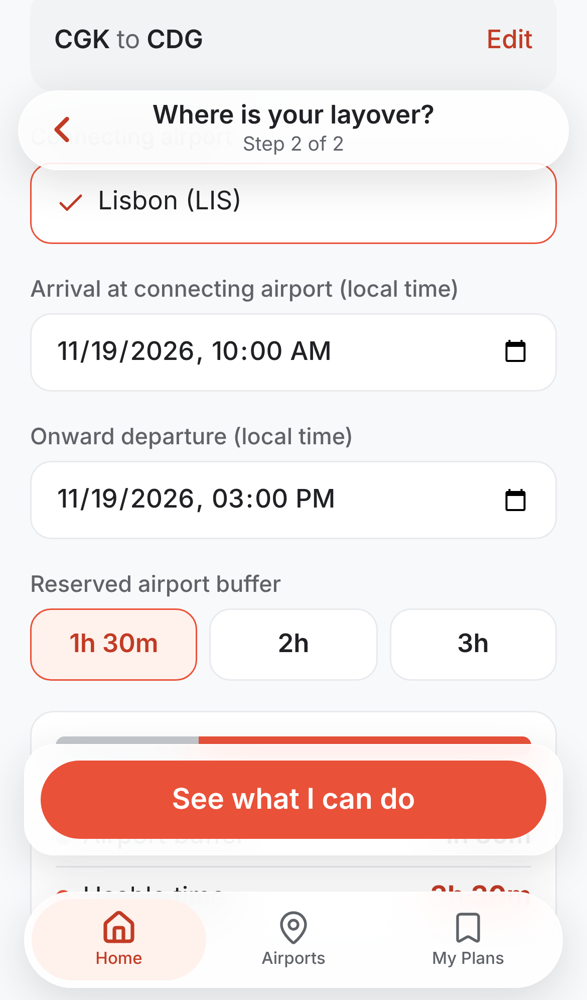

**Figure — Airport map view: schematic of airside / to-be-confirmed / landside zones with activities from the database (illustrative positions).**

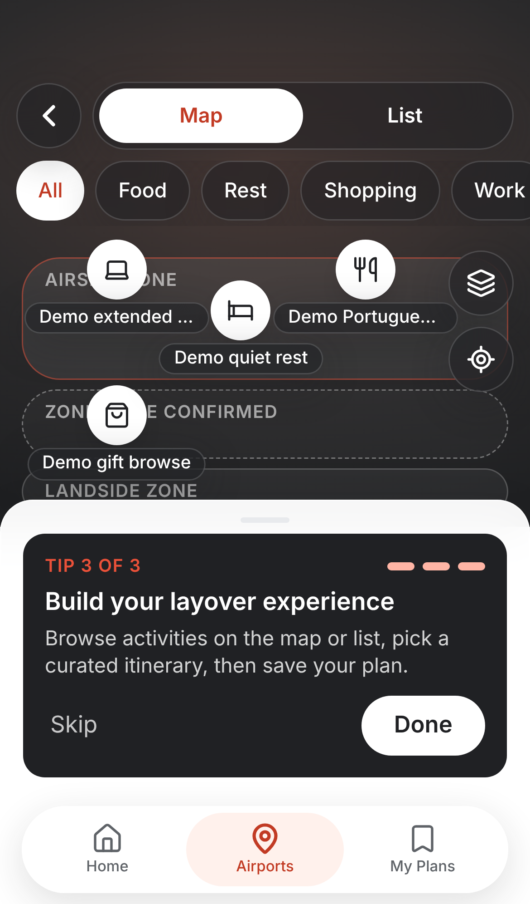

**Figure — Airport list view: airport facts and curated itineraries read from PostgreSQL.**

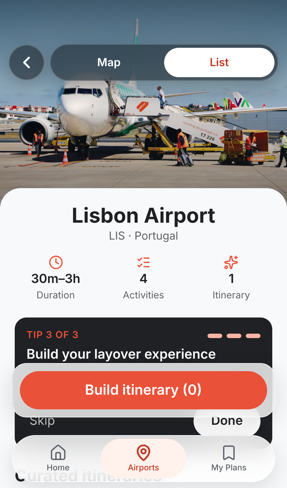

**Figure — Itinerary builder when the plan does not fit: 280 min planned against 210 usable gives "Over your usable time by 1 h 10 m" with a clear warning.**

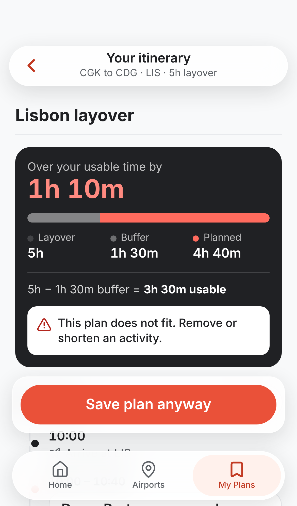

**Figure — Itinerary builder after removing the long activity: 1 h 50 m of usable time remaining; timeline from arrival to departure; Save plan.**

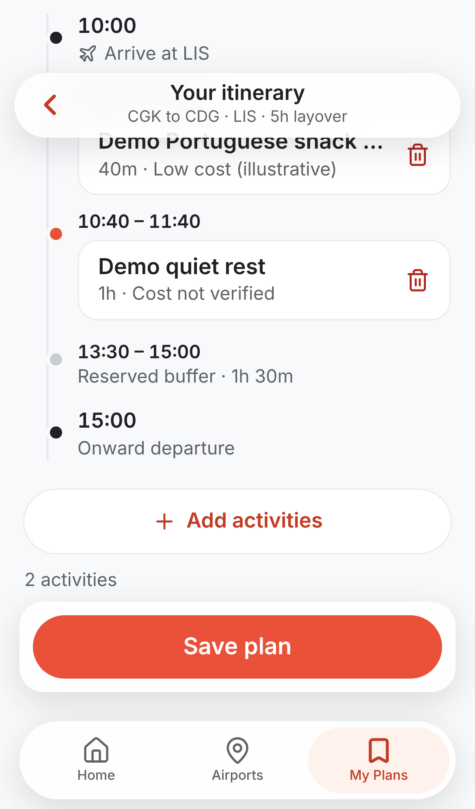

**Figure — After saving: Home shows the personalised "Next connection" ticket, only because this guest has a saved trip in the database.**

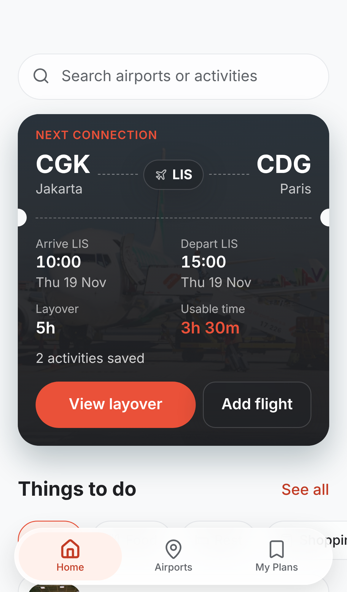

**Figure — Retrieved after a page refresh: the saved plan read back from the database (times, budget, ordered activities).**

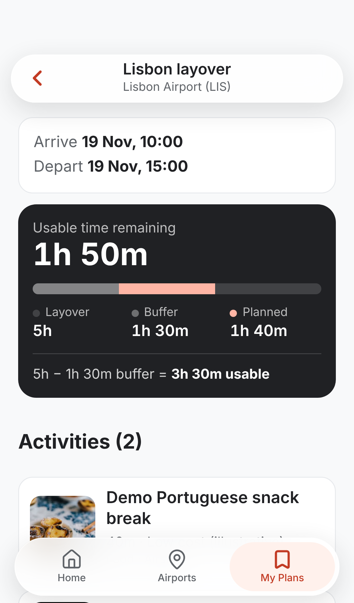

**Figure — Edit: an activity is removed and the remaining time recalculates (2 h 30 m).**

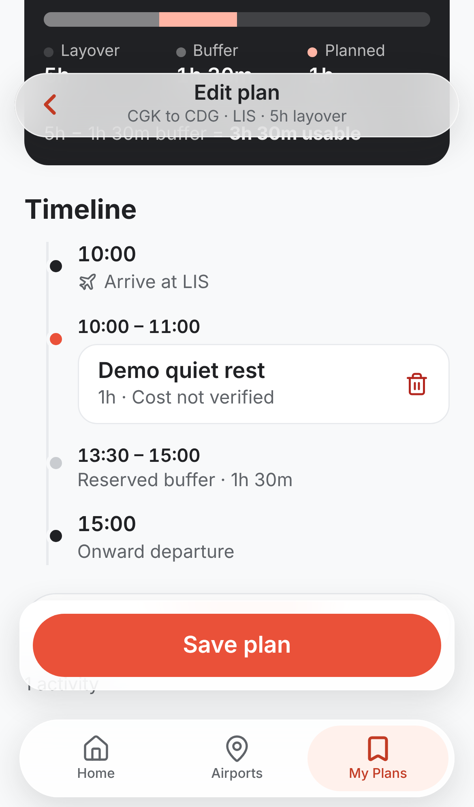

**Figure — My Plans after editing, saved again and refreshing: the edited plan is retrieved (1 activity, 2 h 30 m left).**

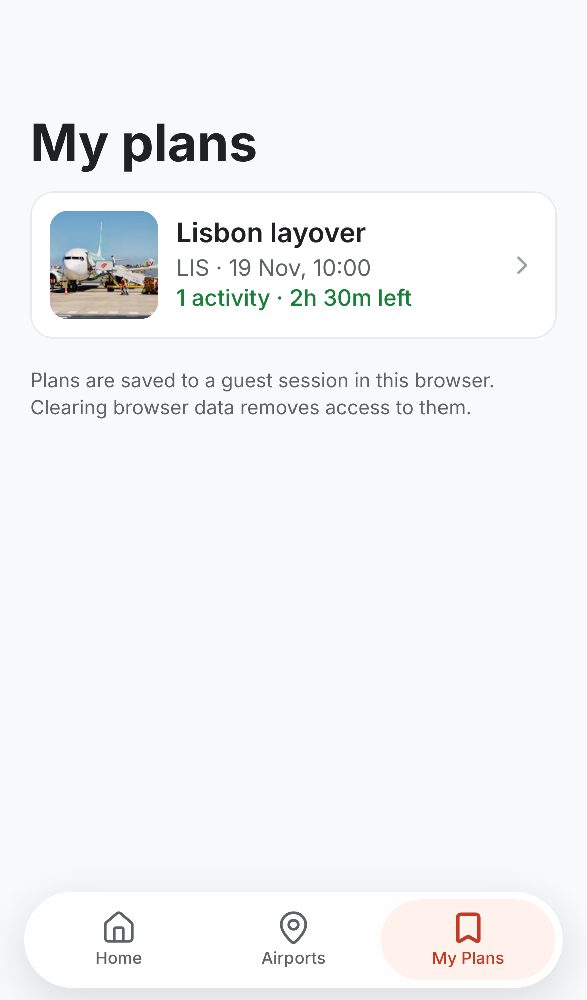

## 5. Testing and verification (what was actually run)
| What | How | Result (2026-11-12) |
|---|---|---|
| Domain logic and data layer (time zones, overnight, daylight-saving gap/overlap, 48 h limit, zero usable time, budget, filters, map layout) | `npm test -- --run` | 70 passed (1 hosted test skipped by default) |
| Database rules (tables, RLS, ownership, atomic save, rollback) in an in-memory PostgreSQL | `npm test --prefix tests/database` | 15/15 passed |
| Full user journey in a real browser (phone viewport) against a **simulated** API: add flight → explore → build → fail/retry save → save → refresh → retrieve → edit → second guest sees nothing → curated itinerary → error and retry states | `npm run build && npm run test:e2e` | 24/24 passed |
| Full user journey in a real browser on the **deployed app and live database** (add flight → explore → over-budget warning → build → save → refresh → retrieve → edit → refresh) | `npm run test:live` | 16/16 passed; all Supabase responses HTTP 200 |
| Real-database journey through the app's own data layer, including a second guest who cannot see or open the first guest's plan | `npm run test:hosted` (run once on the fresh project) | passed |
| Production build | `npm run build` | passed |
AI review of the key screens from phone-sized screenshots was done on 2026-11-12 (findings and fixes in docs/UI_REVIEW.md). Desktop widths, keyboard/accessibility checks and a real-phone check were **not** done. ✏️ Add your own manual check on a real phone.

## 6. Known limitations (honest status)
- **Revision conflicts are not part of the demo and were not exercised on the live API.** The server function reports a conflict (stale edit, or re-creating an existing plan) with error code `PT409`; this is verified only in the local database tests. An earlier version used SQLSTATE `40001`; during testing, calls that hit that path never returned on the hosted API, and the first Supabase project later became unhealthy (the cause was not confirmed; retrying of `40001` is the leading hypothesis). The project was replaced with a fresh one and the code now uses `PT409`.
- Guest sessions: plans are reachable only from the browser that created them; clearing browser data loses access (shown in the app).
- The map is a schematic with illustrative positions; the database has no coordinates. Flight comparison, plan name and origin/destination labels are frontend-only (the schema has no columns for them); the plan name and labels are remembered per browser.
- No delete function for plans (deliberate); no bookings, payments, live flight data or visa checks.
- Photos are illustrative stock images and do not necessarily show the named place.

## 7. Planning, AI-assisted development and review (Assignment 2 §2, §5)
Architecture, folder structure, database design, SPEC and `AGENTS.md` / `CLAUDE.md` rules were written before implementation (docs/ARCHITECTURE.md, docs/DATABASE.md, SPEC.md, AGENTS.md). Implementation was done with Claude Code; every claim above is backed by a command in docs/VALIDATION.md. UI review: docs/UI_REVIEW.md. ✏️ Add your comparison of the running app with your Assignment 1 mockups.

## 8. Items only the student can complete ✏️
- Map each provisional story US1–US6 (SPEC.md) to the real Assignment 1 story IDs: US1 ____, US2 ____, US3 ____, US4 ____, US5 ____, US6 ____.
- Compare the app with your Assignment 1 mockups and record the differences (docs/UI_REVIEW.md).
- Credit the original team's HCI research separately from this individual implementation (see docs/SOURCES_AND_DECISIONS.md for the source documents and authors).
- Upload the PDF and the app link to Moodle before Nov 15 23:59 (Europe/Lisbon), keep the receipt; book the live-demo slot; rehearse twice (docs/DEMO_SCRIPT.md).

## 9. Photo credits (Unsplash, illustrative)
Ankur Khandelwal (https://unsplash.com/@iamankurkhandelwal); Blake Guidry (https://unsplash.com/@blakeguidry); Coleen Rivas (https://unsplash.com/@coleenr); Dennis Gecaj (https://unsplash.com/@dannis); Henry Ren (https://unsplash.com/@henryren); Hugo Silva (https://unsplash.com/@hugomigueldasilva); Johny Goerend (https://unsplash.com/@johnygoerend); Magdalena Raczka (https://unsplash.com/@magda_raczka); Michael Stevanus Hartono (https://unsplash.com/@michaelstevanus); Rach Teo (https://unsplash.com/@rachteo); Rayhan Fahmi (https://unsplash.com/@rayhn_f); Scribbling Geek (https://unsplash.com/@scribblinggeek).
